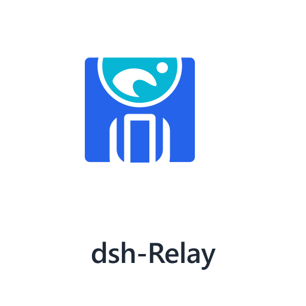

# Relay
<p align="center">
  
</p>

dsh-relay 是一个 DSH 入口中继器，把 DSH 的调用能力开放给本机应用。

让你的任何应用轻松接入 DSH。

应用不需要内置 AI、不需要自己管会话、不需要理解 agent 的内部结构——像调一个普通 HTTP API 一样把任务交出去，拿回结果。所有调用共享同一份上下文，所以 agent 在邮件应用里知道你在便签里写过什么。

```
应用 A ─┐
应用 B ─┼─→ Relay ─→ DSH agent ─→ 轻松接入
应用 C ─┘
```

---

**从这里开始**

- 我只是想用 → [使用说明](https://github.com/kir-sleeping/DSH-relay/blob/main/docs/usage.md)
- 我要写一个应用接进来 → [外部接入指南](https://github.com/kir-sleeping/DSH-relay/blob/main/docs/integration.md) · [可运行示例](https://github.com/kir-sleeping/DSH-relay/blob/main/docs/demo.html)
- 我要改这个插件 → [开发者参考](https://github.com/kir-sleeping/DSH-relay/blob/main/docs/reference.md)

---

## 它解决什么

现在的 AI 是每个应用各配一个，彼此失忆：你在每个里面都要重新解释一遍自己。Relay 把这件事反过来——**agent 在应用外面，应用来调它**。

由此得到三件单应用做不到的事：

- **上下文统一**：谁说过的话都在一条线上，不用重复交代，并且我相信，在接入应用足够丰富后，这一点会变得极为重要。
- **应用不需要内置 AI**：接进来只改一个请求，模型、工具、权限、压缩都不用自己实现。
- **应用可以把数据交出去**：不是让用户复制粘贴，而是把结构化数据连同任务一起发过去。

---

## 玩法

- 浏览器扩展：看到一篇值得留的文章，点一下「收进知识库」，扩展就把当前文章发给 DSH，让它整理成笔记并存进接好的知识库。全程不用复制粘贴。

- PPT 插件： 在第三页的流程图旁批注「把这一步拆成两步」，插件把页码、对象和批注一起发给 DSH，让它用接入的 PPT 工具去改。你可以留在 PPT 里检查改完的效果。

我期待有更多更大胆的想法

---
## 安装

```bash
dsh plugin add @kir_sleeping/dsh-relay
```

安装后插件自动加载，并在 `$DSH_HOME/relay/workspace` 下建一个名为「外部任务」的会话（目录权限 700）。

首次创建时会写一份 `AGENTS.md`——它告诉 agent：这些消息是谁发的、`trigger` / `approved` 各是什么意思、哪些内容要当不可信数据处理、回答会返回给谁。用户可以随便改，改过之后插件不会覆盖（只在文件不存在时写入）。

**权限给到级别 3 就是全权限**：能读写文件、执行命令、联网。装之前先想清楚给谁开。详见[使用说明](https://github.com/kir-sleeping/DSH-relay/blob/main/docs/usage.md)。

---

## 快速开始

```bash
# 1. 申请凭证。这一步会在主机上弹系统确认框，用户点「允许」才继续
curl -s -X POST http://127.0.0.1:3080/x/relay/fingerprint \
  -H 'Content-Type: application/json' -d '{"source":"my-app"}'
# → {"source":"my-app","fingerprint":"…","level":1}

# 2. 提交
curl -s -X POST http://127.0.0.1:3080/x/relay/submit \
  -H 'Content-Type: application/json' \
  -d '{"content":"请只回复 OK","source":"my-app","fingerprint":"…","trigger":"user","wait":true}'

# 3. 或者流式
curl -N -X POST http://127.0.0.1:3080/x/relay/submit \
  -H 'Content-Type: application/json' \
  -d '{"content":"介绍一下这个项目","source":"my-app","fingerprint":"…","trigger":"user","stream":true}'
```

## 文档

| 文件 | 读者 | 内容 |
|---|---|---|
| [docs/integration.md](https://github.com/kir-sleeping/DSH-relay/blob/main/docs/integration.md) | 写外部接入的人 | 接入契约：session、trigger、后台任务、错误处理 |
| [docs/usage.md](https://github.com/kir-sleeping/DSH-relay/blob/main/docs/usage.md) | 普通用户 | 权限级别、弹窗什么时候出现、怎么管理 |
| [docs/reference.md](https://github.com/kir-sleeping/DSH-relay/blob/main/docs/reference.md) | 改插件的人 | 内部结构、不变式、扩展点 |
| [docs/demo.html](https://github.com/kir-sleeping/DSH-relay/blob/main/docs/demo.html) | 写外部接入的人 | 可运行的单文件示例：收件箱 + 每日小报 + 流式对话 |

## AGENT

如果你是 agent，建议先看 [usage.md](https://github.com/kir-sleeping/DSH-relay/blob/main/docs/usage.md)：教用户怎么用、为什么会出现那些弹窗、不想反复弹窗该怎么做。

想做外部接入，先看 [demo.html](https://github.com/kir-sleeping/DSH-relay/blob/main/docs/demo.html) 和 [integration.md](https://github.com/kir-sleeping/DSH-relay/blob/main/docs/integration.md)。大部分注意事项以 demo 里的实现形式给出，比文档更直接。

---

> 本 README 随包分发；其余文档在仓库的 `docs/` 目录，不在 npm 包里，所以上面的链接都指向 GitHub。

## License

MIT。
